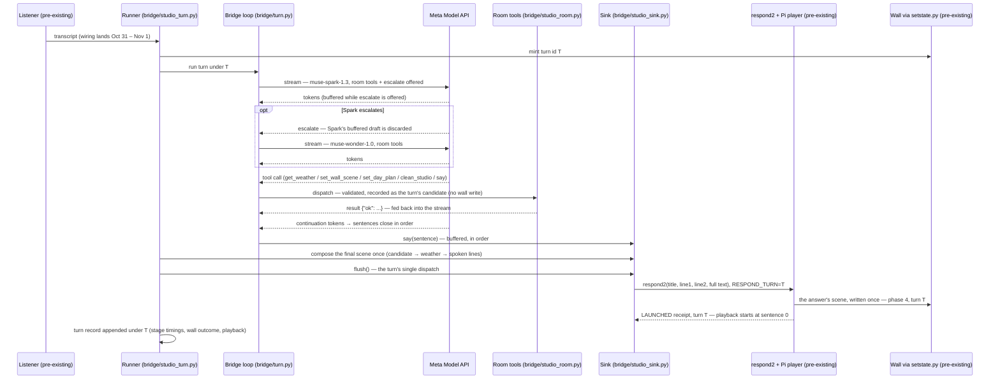

# MuseZ Home

A low-latency voice bridge for a real room: the **Meta Model API** (Muse Spark, streaming) drives a Raspberry Pi ambient wall display and a room speaker, so a spoken request becomes a spoken answer and an on-wall scene in seconds — measured, not promised.

Built for the **Meta Global AI Developer Hackathon** (Oct 26 – Nov 4, 2026) — Indie Developer track, **Build for Your World** theme.

> **Status — Oct 29, 2026:** Live Meta Model API: credits applied 2026-10-29; live latency probes run 2026-10-29 (bare API stage, then through the production path) — results in `experiments/results/`. Room integration (listener → bridge) lands Oct 31 – Nov 1.

## The proof, up front

- **Models** — `muse-spark-1.3` answers first: streaming, with the room's tools offered as function calls. When a turn needs deeper reasoning, Spark hands it to `muse-wonder-1.0` through an internal `escalate` call, before answering — Wonder is the escalation target, never the first responder.
- **Room tools the models can call** — `get_weather` (Tamarac, FL: today, a 7-day forecast, hourly precipitation), `set_wall_scene` (a title and up to two lines, validated against the wall's design budget before they can land), `set_day_plan` (a structured day-plan timeline), `clean_studio` (starts the robot vacuum cleaning the studio), and `say` (a spoken acknowledgement inside the turn).
- **Measured — through the bridge's own production path** (Oct 29, 2026; the bridge's real client, system prompt and tool schemas, tools dispatched at their measured latencies, n = 5 per arm, 0 errors — the model stage of real bridge turns, **not** end-to-end room turns: STT, TTS and transport land with the room integration): Spark's first token *is* its first complete sentence at median **1.8 s** on both weather and knowledge turns; full Spark turns run **2.7–5.8 s**. An escalated planning turn hears Wonder's first sentence at **8.4 s** (median) and delivers the full plan in **29.1 s** — the measured reason Wonder only receives escalations. An earlier bare-prompt probe the same day (n = 10, no production request shaping) measured Spark's first token at 3.6 s: the gap is the production configuration, and the bare numbers survive only as that comparison. Full results: [`experiments/results/latency-live-prod-2026-10-29.md`](experiments/results/latency-live-prod-2026-10-29.md) (bare probe: [`latency-live-2026-10-29.md`](experiments/results/latency-live-2026-10-29.md)).
- **The baseline it replaces** — the room's pre-event chat path: median transcript → first audio **50.9 s** (n = 7, measured 2026-10-23). Bridge room turns will be published on the same definition once the Oct 31 – Nov 1 integration lands.
- **Demo video** — lands Nov 4.

## Why

My assistant lives on my phone and on my computer: the same voice and the same memory, everywhere. My studio was the missing place — the room where I spend my days building. This bridge exists so she is present here too: the room that hears her, answers her and shows her.

## What it does

You say "Hey Muse" in the studio. The room listens, transcribes locally, and sends the text to Muse Spark through the Meta Model API with function calling wired to the room's real tools (wall scenes, voice replies, live data). Spark streams back; the bridge cuts the stream into sentences as they close and composes the spoken reply incrementally. When the turn ends, the bridge dispatches it in a single pass through the room's existing response path — playback starts at sentence 0 while the remaining sentences stream in behind it — and the turn's one wall scene lands with the voice, under the turn's own id. Until a speculative renderer exists, the voice-start numbers in this repo are computed from the full turn, not from its first sentence. Every stage of every turn is timed and logged, because for voice in a room, **latency is the product**.

## What was built during the hackathon (Oct 26 – Nov 4, 2026)

- The **bridge**: transcript → Meta Model API (Muse Spark streaming + function calling) → sentence-chunked speech and wall scenes, with escalation to **Muse Wonder** for turns that need deeper reasoning.
- The **latency probe and budget**: per-stage timing (first token, first complete sentence, TTS render, playback dispatch), published as all points + median + range — a p95 is only claimed on ≥ 30 warm calls per arm.
- The tool layer that lets the models act on the room: wall scene control, voice reply dispatch, and live-data tools.
- The **studio integration**: the bridge loop driving the room's real surfaces — tool calls that act on the wall through the Pi's guarded state writer, and speech delivered through the studio's existing response transport (same voice, same player) — verified end to end in the room with the mock source; the live-source wiring is the Oct 31 – Nov 1 step (see Status above).
- This documentation, the measured results, and the demo.

## The room it runs in

MuseZ Home plugs into a personal studio its builder has been developing as a long-running project: a Raspberry Pi 5 running a projected ambient wall, a local wake-word listener ("Hey Muse") with a USB microphone array and a room speaker, and a speech pipeline with a watchdog that verifies spoken replies actually play. That system is the stage — a body that already existed. What this event adds is the brain: a dedicated, measured bridge from the room to Meta's Muse models.

## Provenance: what was built here, what already existed

The split below is the submission's claim, stated once: the bridge is the work of Oct 26 – Nov 4, 2026; the room it drives is the pre-existing stage.

### Built Oct 26 – Nov 4, 2026 (this repository)

| Component | Path | Evidence |
|---|---|---|
| Turn loop + sentence chunker | `bridge/turn.py`, `bridge/sentence_chunker.py` | Test suite (`bridge/test_*.py`); mock demo end to end (`bridge/mock_demo.py`) |
| Live Meta Model API source, Spark → Wonder escalation | `bridge/meta_source.py` | Offline tests with a fake transport (`bridge/test_meta_source.py`); live probe, Oct 29 — 20 calls, 0 errors (`experiments/results/probe-live-2026-10-29.jsonl`) |
| Tool layer (schemas + dispatch contract) | `bridge/tools.py` | The five tools above; dispatch never raises — failures return `{"ok": false}` for the model to react to |
| Day-plan composer (structured infographic payload) | `bridge/day_plan.py` | `bridge/test_day_plan.py`; deterministic composer over the real forecast shape, no model required |
| Studio room, sink and runner (the room adapter) | `bridge/studio_room.py`, `bridge/studio_sink.py`, `bridge/studio_turn.py`, `bridge/wall_apply.py` | Verified end to end in the room with the mock source, Oct 27 — turn records in `experiments/results/bridge-studio-mock.jsonl` (incl. an ON-hours run: scene read back on the wall, sentence 0 played) |
| Latency probe + results | `experiments/latency_probe.py`, `experiments/results/` | Mock runs and the live run of Oct 29, raw records alongside the summaries |
| Documentation and demo script | `docs/`, this README | — |

### Pre-existing stage, not submitted

| Component | Role | The contract the bridge uses |
|---|---|---|
| Wall renderer + the wall's closed design system (design criteria closed 2026-10-15) | Renders the projected scenes; owns the scene vocabulary and the phase ladder (1 listening … 4 answer … 5 home) | The bridge never writes the wall directly — see `setstate.py` |
| `setstate.py` (Pi, `~/pared/`) | The wall's only sanctioned write path; its guard enforces turn/phase order | Invoked by the Pi-side helper (`bridge/wall_apply.py`) with a validated payload: `--turn=<id> --phase=<n>`; rejections come back as exit code 4 and are never retried blind |
| Turn minter (`setstate.py --mint-turn`) | Mints the turn ids every surface agrees on | One id per turn, minted before the turn runs; the same id threads the model calls, the wall write and the playback |
| Listener (Pi, `~/pared-tools/listener.py`) | Wake word ("Hey Muse") + local STT → transcript | The Oct 31 – Nov 1 wiring feeds its transcripts to the bridge; until then the runner takes the transcript directly |
| `respond2.sh` + the Pi receiver/player (respond_recv → sayseq) | The room's response transport: TTS in the room's own voice (Warm, Spanish) and playback; writes the answer's scene at phase 4 | Exactly four arguments — title, line 1, line 2, full text — plus `RESPOND_TURN=<id>` in the environment; one dispatch per turn; the `LAUNCHED` line is the receipt |
| `fastwx.sh` (`~/workspace/studio/`) | The room's Open-Meteo feed for Tamarac, FL | `get_weather` reads today + 7-day forecast + hourly precipitation through it |
| Response watchdog (respwatch) | Verifies spoken replies actually played | The bridge runner reads the same sayseq/playgate logs to record each turn's playback outcome |

### One turn, end to end

Every arrow below carries the same turn id `T`, minted by the Pi before the turn runs:



### The room adapter boundary

The bridge core — turn loop, sentence chunker, model source — talks to the room through two narrow interfaces, and everything studio-specific lives behind them:

- **A sink**: `say(sentence)` per closed sentence, in order; `set_scene(title, lines[, scene])` once; `flush()` → a receipt. The sink owns how speech and the final scene reach the room, in a single dispatch.
- **A room**: one method per tool in `bridge/tools.py`, each returning a JSON-able dict and never raising — failures come back as `{"ok": false, "error": ...}` for the model to react to.

A different room reuses the bridge by implementing those two interfaces against its own surfaces: its own scene writer behind `flush()`, its own data feeds behind the tool methods. This studio's adapter is `bridge/studio_room.py` + `bridge/studio_sink.py` + `bridge/wall_apply.py` — the Pi's host and paths, `setstate.py`'s guard, respond2's four-argument contract, `fastwx.sh` and Tamarac are that adapter's business, not the bridge's.

## Architecture

```
voice → wake word → local STT → transcript
      → bridge → Meta Model API (Muse Spark, streaming, function calling;
                   escalate → Muse Wonder for turns that need depth)
      → sentence chunker composes the reply sentence by sentence
      → single dispatch at turn end → TTS → room speaker (sentence 0 first)
                                     ↘ one wall scene, same turn id (Pi display)
      → per-stage timing log (every turn)
```

### Day-plan scenes

Planning turns ship a structured scene, not just a card: a day plan
(`bridge/day_plan.py`) is a validated timeline payload — an ordered
list of blocks (activity / rain / free / note) with the rain band
derived from the real hourly forecast — so a planned Saturday reads
as an infographic: the morning activity placed in the dry hours, the
rain drawn as a band. The model can submit one (`set_day_plan`), and
a deterministic composer builds the same payload from the forecast
with no model involved, so the demo's plan never depends on
free-form generation. A plan rides the turn's single wall write at
flush time, alongside a card summary composed from the same payload.
**Status:** the bridge validates and ships the payload today; the
wall page does not render the `plan` kind yet — rendering is a
separate prototype step, and until it lands the card summary is what
the wall shows.

## Latency budget (targets vs measured)

| Stage | Target | Measured |
|---|---|---|
| Spark: first token | ≤ 2 s | median 1.76–1.81 s through the production path (n = 5 per arm, Oct 29) — met at median; worst point 2.16 s |
| Spark: first complete sentence (streaming) | ≤ 4 s | median 1.8 s, both classes (production path, Oct 29) — met |
| TTS render, first sentence (room transport) | ≤ 3 s | baseline ~1.97 s (7-word sentence) |
| **Perceived total to first voice** | **≤ ~12 s** | Room validation lands Oct 31 – Nov 1; the measured model+TTS floor is ≈ 4.6 s (simple turns) to ≈ 7.7 s (weather turns) on the whole-turn basis — full budget in `docs/latency-budget.md` |

The baseline this replaces — the pre-event chat path — measured a median transcript → first audio of 50.9 s (n = 7, 2026-10-23). Measured results live in `experiments/results/`. If a stage misses its target, the writeup says so and shows the number.

## Repository layout

- `bridge/` — the bridge code (Spark client, sentence chunker, tool dispatch).
- `experiments/` — the latency probe (`latency_probe.py`) and its measured results.
- `docs/` — design notes, including the latency budget rationale.

## Running the latency probe

```bash
# Mock mode: no network, no API key — verifies the harness end to end
python3 experiments/latency_probe.py --mock --runs 5

# Live mode: needs META_API_KEY in the environment (never commit it)
META_API_KEY=... python3 experiments/latency_probe.py --live --runs 10
```

## License

MIT — see `LICENSE`.
